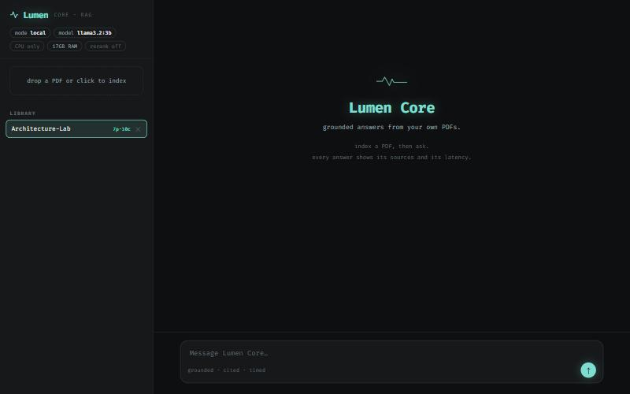
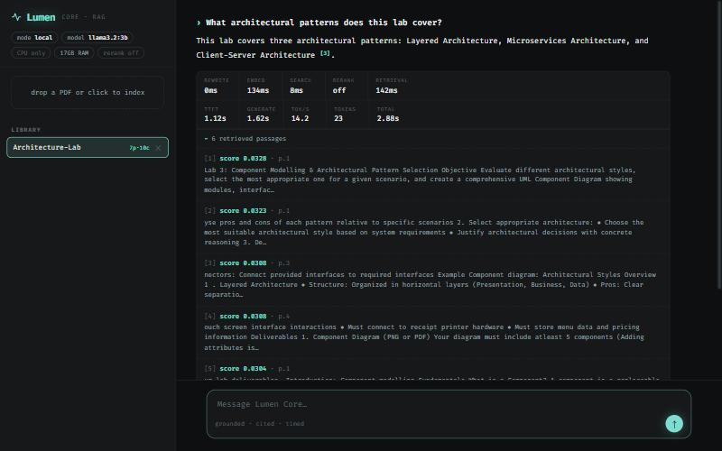

# Lumen Core — RAG console

A barebones, performance-focused front end for the same local RAG engine that
powers Lumen — **no Electron, no music, themes, notes, planner, or timer**. Just
the retrieval pipeline, exposed with full telemetry.



It's one static `index.html` (no build step) that talks to the Node/Express RAG
server in [`../backend/rag`](../backend/rag). The engine is identical to the
desktop app's: page-aware chunking, hybrid dense + BM25 retrieval fused with
RRF, optional GPU-gated LLM reranking, and SSE-streamed, citation-grounded
answers against a local Ollama model (or any OpenAI-compatible API).

## Why it exists

The desktop app optimizes for ambience. This optimizes for **seeing the
machine work**. Every answer shows:

- **Retrieval latency**, broken down: query rewrite → embed → vector/keyword
  search → rerank.
- **Generation metrics**: time-to-first-token, generation time, tok/s, token
  count, end-to-end total.
- **Retrieved passages** with their fused similarity scores and source pages.
- **Hardware & config**: mode, model, GPU/VRAM (or CPU/RAM), rerank state.



> Real run above: `llama3.2:3b` + `nomic-embed-text` on a CPU-only laptop —
> retrieval in ~140 ms, answer grounded with a `[3]` citation, and every
> passage shown with its fused similarity score and source page.

## Run

```bash
cd backend && npm install && npm run rag
```

Then open **http://localhost:5001/core**. Drop in a PDF, pick it, and query.

### Local models, zero terminal steps

The server **auto-starts Ollama** if it's installed, and the console shows a
**"Set up local AI"** banner that pulls any missing models (`nomic-embed-text`
for embeddings, `llama3.2` for chat) with one click — `nomic-embed-text` runs
the embeddings directly in Ollama, no LM Studio. If Ollama itself isn't
installed, run `npm run setup` from the project root first (it installs Ollama
and the models). Prefer an API provider instead? Set API mode in
`backend/rag-data/config.json`. See [`../MODELS.md`](../MODELS.md).

Endpoints behind the banner: `GET /api/rag/provision/status` (what's
installed/missing) and `POST /api/rag/provision` (SSE — starts Ollama and pulls
the required set, or an explicit `{"models":[...]}`).

> The telemetry is server-measured (`process.hrtime`) and streamed over the
> same SSE channel as the answer, so the numbers reflect the backend, not
> browser paint time. `tok/s` is stream-chunks per second — a close proxy for
> tokens on Ollama.
